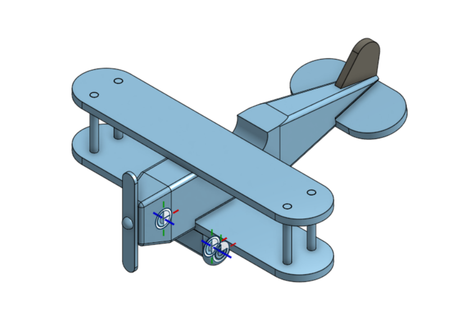

# Airplane CAD

A 3D airplane model designed in Onshape by me 

## Preview

## Preview

## CAD Model

**Designed with:** Onshape

**Live model:** (https://cad.onshape.com/documents/67baea7fac7ee3f6df7c0693/w/4f8354e641037b7147c0dc47/e/85542826da5a7273726a65c6)

## Project File

The exported CAD files are available in this repository.
https://github.com/AakristaDhungana/airplane-cad

## About

This is my airplane CAD project, designed in Onshape. I worked on the model shape and main structure and explored the tools used to create a 3D design.

